<div align="center">

# ⚽ MatchPoint

**Reserva y gestión de canchas deportivas**


</div>

| | |
|---|---|
| **Universidad** | Universidad Nacional de San Agustín de Arequipa |
| **Escuela** | Ingeniería de Sistemas · Facultad de Ingeniería de Producción y Servicios |
| **Curso** | Tecnología de Objetos |
| **Docente** | Mg. Maribel Molina Barriga |
| **Grupo** | Grupo 1 |
| **Entregables** | [Informe](entregables/Informe_MatchPoint_Grupo1.pdf) · [Artículo](entregables/Articulo_MatchPoint_Grupo1.pdf) · [Diapositivas](entregables/Diapositivas_MatchPoint_Grupo1.pdf) ([.pptx](entregables/Diapositivas_MatchPoint_Grupo1.pptx)) |
| **Probar rápido** | [10. Compilación y ejecución](#10-compilación-y-ejecución) · [casos de prueba](docs/CASOS_DE_PRUEBA.md) |

---

## Contenido
1. [Introducción](#1-introducción)
2. [Objetivos](#2-objetivos)
3. [Descripción del problema](#3-descripción-del-problema)
4. [La solución: MatchPoint](#4-la-solución-matchpoint)
5. [Diseño de la solución](#5-diseño-de-la-solución)
6. [Patrones de diseño](#6-patrones-de-diseño)
7. [Conceptos de POO avanzada](#7-conceptos-de-poo-avanzada)
8. [Flujo de ejecución](#8-flujo-de-ejecución)
9. [Reglas de negocio](#9-reglas-de-negocio)
10. [Compilación y ejecución](#10-compilación-y-ejecución)
11. [Resultados](#11-resultados)
12. [Ventajas y consideraciones](#12-ventajas-y-consideraciones)
13. [Conclusiones](#13-conclusiones)
14. [Exposición y video](#14-exposición-y-video)
15. [Estructura del repositorio](#15-estructura-del-repositorio)
16. [Integrantes](#16-integrantes)
17. [Referencias](#17-referencias)

---

## 1. Introducción

La programación orientada a objetos permite construir sistemas grandes a partir de clases pequeñas, cada una con
una responsabilidad clara. Los **patrones de diseño** ofrecen soluciones conocidas para organizarlas, y la
arquitectura **Modelo-Vista-Controlador (MVC)** separa los datos y las reglas de la interfaz.

En este proyecto final se aplican esos conceptos a un problema real: **reservar canchas de fútbol y organizar
partidos**. El resultado es **MatchPoint**, una aplicación de escritorio en **C++17** con **Qt 6** y **SQLite**,
que integra lo visto en el curso: herencia, polimorfismo, punteros inteligentes, templates, manejo de errores,
lambdas, sobrecarga de operadores, multithreading, patrones creacionales y estructurales, Git, CMake y pruebas.

## 2. Objetivos

**General:** desarrollar una plataforma de reserva y gestión de canchas deportivas aplicando programación
orientada a objetos avanzada, patrones de diseño y la arquitectura MVC en C++.

**Específicos:**
- Separar el sistema en **Modelo, Vista y Controlador**, con un modelo que no dependa de la interfaz.
- Aplicar patrones **creacionales** (Factory Method, Singleton) y **estructurales** (Decorator, Composite).
- Usar herencia, polimorfismo, `unique_ptr`, templates, excepciones, lambdas y sobrecarga de operadores.
- Evitar reservas duplicadas cuando dos operaciones ocurren a la vez (**mutex**) y guardar los datos en
  **SQLite** desde un hilo aparte (**productor-consumidor**).
- Verificar las reglas de negocio con **pruebas unitarias** y la aplicación con **casos de aceptación**.

## 3. Descripción del problema

Para jugar un partido hay que llamar a varias canchas para saber si tienen horario, cuánto cobran y dónde
quedan. Después hay que **completar los jugadores** (o conseguir un **equipo rival**), **cobrarle a cada uno su
parte** y lidiar con quienes **cancelan a última hora**. Los dueños, por su lado, manejan las reservas por
WhatsApp o en un cuaderno, hay cruces de horarios y pierden dinero con las cancelaciones.

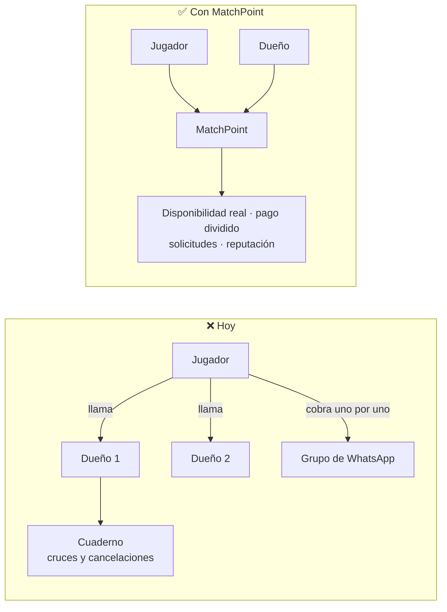

## 4. La solución: MatchPoint

**MatchPoint** es una plataforma de escritorio (C++17 + Qt 6) para la **reserva y gestión de canchas
deportivas**. Registra usuarios, centros deportivos, canchas y horarios; permite consultar la disponibilidad y
reservar **sin conflictos de horario**, crear partidos y **buscar jugadores o un equipo rival**, y gestiona
cancelaciones, **listas de espera**, historial de reservas, estados de los partidos y una **reputación
bidireccional**: los jugadores califican las canchas y el dueño califica a los jugadores. Los datos se guardan en
**SQLite**.

| Para el jugador | Para el dueño de cancha |
|---|---|
| Ver canchas con distrito, dirección, precio y calificación | Registrar y editar sus canchas (precio, horario) |
| **Grilla semanal** de cada cancha (próximos 7 días): libre, busca jugadores, busca rival, mi partido, ocupado | **Grilla semanal** con la ocupación de cada una de sus canchas |
| Reservar con un clic en un horario libre, con extras: pelota, chalecos, árbitro | Ver las reservas recibidas |
| Tres modos: **privada**, **buscar jugadores** ("somos 6, buscamos 4") o **buscar equipo rival** (mitad y mitad) | **Calificar a los jugadores** con un botón: Todo bien 5 ★, Llegaron tarde 3 ★, No vinieron 0 ★ |
| Si el partido no se completa: aviso, **"Jugar así"** o cancelación automática con devolución total | Ver primero los partidos de hoy que faltan calificar |
| **Lista de espera** en partidos completos | |
| **Solicitudes**: pedir unirse (o retar con tu equipo); aceptar o rechazar a quienes piden entrar a los tuyos | Organizar **torneos** todos contra todos |
| Cancelar o retirarse (con multa si es tarde) | Registrar resultados y ver la tabla de posiciones |
| Crear equipos (titulares y suplentes) e inscribirlos en torneos | Recibir los pagos al instante, con comprobante |
| **Mis pagos**: tarjeta guardada e historial con comprobantes | **Ingresos**: historial de cobros y multas |
| Botones en cada fila (Jugar así, Cancelar, Retirarme, Calificar, Aceptar, Rechazar) | Botones en cada fila (Todo bien, Llegaron tarde, No vinieron, Iniciar, Registrar) |
| Calificar canchas · Ranking de canchas y jugadores · Notificaciones por tipo y por día | Ranking · Notificaciones |

> El pago es **simulado** (pasarela de pago): el jugador registra los 4 últimos dígitos de su tarjeta,
> cada pago se aprueba al instante y genera un comprobante (`MP-000001`) que ven el que paga y el que recibe.
> Una tarjeta terminada en `0000` simula un pago rechazado por el banco.
> Quedan fuera del alcance: apuestas, mapa real (Google Maps) y pagos reales.
> **Solo fútbol:** el sistema maneja un único deporte porque varios deportes (reglas, tamaños de equipo y canchas
> distintas) complicarían la lógica sin aportar a los objetivos del curso; el diseño permite agregarlos después.

## 5. Diseño de la solución

### 5.1 Arquitectura MVC

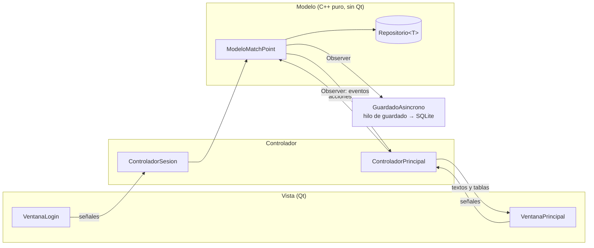

- **Modelo** (`src/modelo`): datos y reglas. No incluye ningún archivo de Qt, por eso se prueba sin ventanas.
- **Vista** (`src/vista`): solo widgets. No conoce `Cancha`, `Reserva` ni el modelo: recibe textos y emite señales.
- **Controlador** (`src/controlador`): traduce las señales de la vista en llamadas al modelo, atrapa los
  errores y convierte los datos del modelo en filas de tabla.

### 5.2 Diagrama de clases del modelo

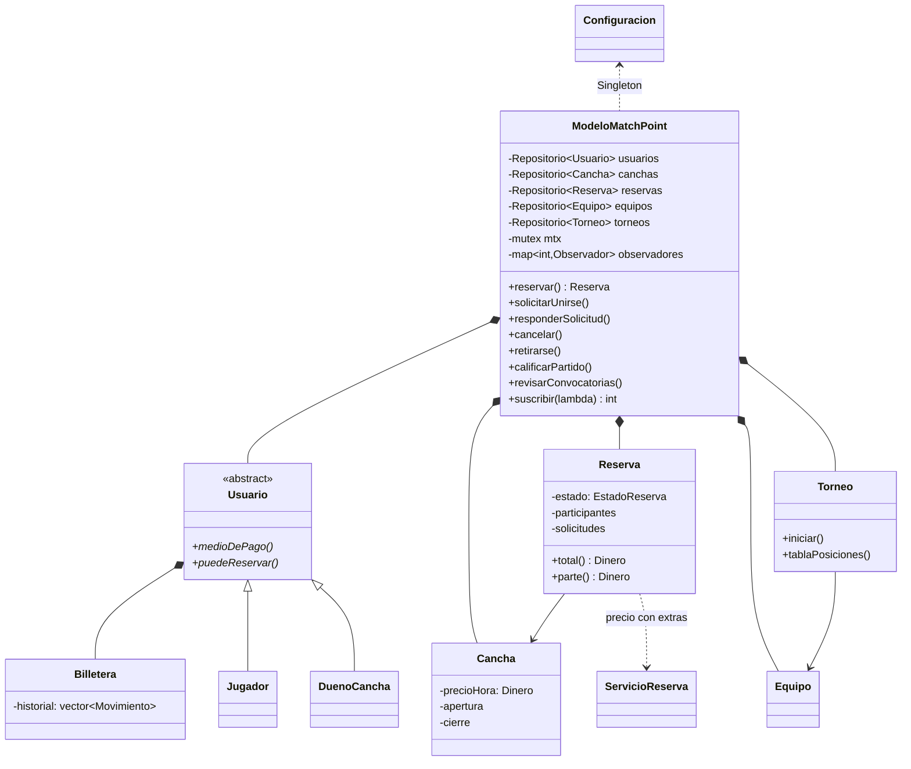

- `ModeloMatchPoint` es el **único punto de entrada** al modelo: guarda todo en repositorios genéricos y aplica
  las reglas de negocio.
- Las relaciones `*--` son de **composición**: el modelo es dueño de sus objetos mediante `unique_ptr`.

## 6. Patrones de diseño

| Tipo | Patrón | Dónde | Para qué |
|---|---|---|---|
| Creacional | **Factory Method** | `UsuarioFactory.h` | Crear `Jugador` o `DuenoCancha` sin que el resto del código conozca las subclases |
| Creacional | **Singleton** | `Configuracion.h` | Reglas globales únicas: multa, tolerancia, días reservables, precios de extras, tarjeta rechazada |
| Estructural | **Decorator** | `ServicioReserva.h` | Sumar extras (pelota, chalecos, árbitro) al alquiler sin una subclase por combinación |
| Estructural | **Composite** | `Equipo.h` | Equipo → grupos (titulares, suplentes) → jugadores, tratados de forma uniforme; se usa en torneos y en partidos equipo contra equipo |
| Comportamiento | **Observer** | `ModeloMatchPoint.h` | El modelo avisa los cambios a la ventana, a las notificaciones y al guardado |
| Arquitectónico | **MVC** | `src/` | Separar datos, interfaz y control |

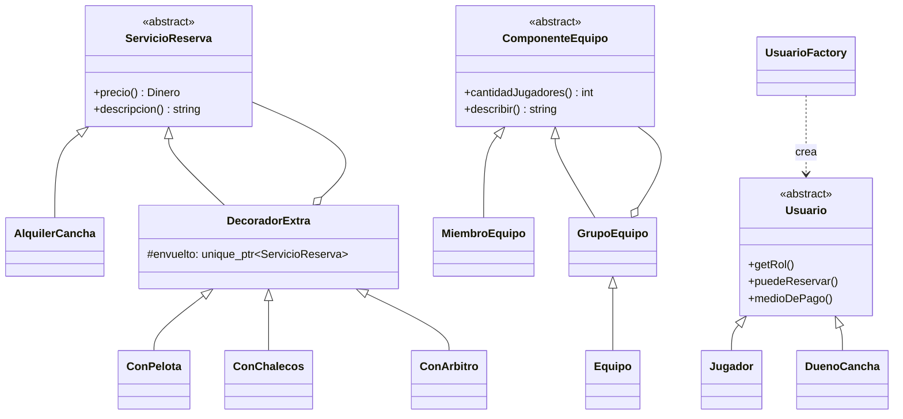

### 6.1 Factory Method — `UsuarioFactory.h`

El único lugar que conoce las subclases de `Usuario`. El resto del programa trabaja solo con `Usuario`.

```cpp
static std::unique_ptr<Usuario> crear(TipoUsuario tipo, const std::string &nombre, ...) {
    switch (tipo) {
        case TipoUsuario::JUGADOR: return std::make_unique<Jugador>(nombre, correo, claveHash, detalle);
        case TipoUsuario::DUENO:   return std::make_unique<DuenoCancha>(nombre, correo, claveHash, detalle);
    }
    throw ValidacionError("Tipo de usuario no reconocido");
}
```

### 6.2 Singleton — `Configuracion.h`

Las reglas globales (multa, tolerancia, precios de extras, estrellas) existen **una sola vez**.

```cpp
static Configuracion &obtenerInstancia() {
    static Configuracion instancia;   // se crea una sola vez (thread-safe desde C++11)
    return instancia;
}
Configuracion(const Configuracion &) = delete;              // sin copias
Configuracion &operator=(const Configuracion &) = delete;   // ni asignaciones
```

### 6.3 Decorator — `ServicioReserva.h`

Cada extra **envuelve** al servicio anterior y le suma su precio, sin una subclase por combinación.

```cpp
class ConPelota : public DecoradorExtra {
    Dinero precio() const override { return envuelto->precio() + Configuracion::obtenerInstancia().precioPelota(); }
    std::string descripcion() const override { return envuelto->descripcion() + " + pelota"; }
};

// Cancha + pelota + árbitro = ConArbitro(ConPelota(AlquilerCancha))
std::unique_ptr<ServicioReserva> servicio = std::make_unique<AlquilerCancha>(precioBase);
for (const auto &extra : extras)
    if (extra == "pelota") servicio = std::make_unique<ConPelota>(std::move(servicio));
```

### 6.4 Composite — `Equipo.h`

Un equipo contiene grupos (titulares, suplentes) que contienen jugadores. A todos se les pide lo mismo.

```cpp
class GrupoEquipo : public ComponenteEquipo {
    std::vector<std::unique_ptr<ComponenteEquipo>> hijos;
    int cantidadJugadores() const override {
        int total = 0;
        for (const auto &h : hijos) total += h->cantidadJugadores();   // recursivo
        return total;
    }
};
```

Se usa en los **torneos** (equipos de 5 o más) y en **equipo contra equipo**: para validar que nadie juegue en
los dos equipos se recorre el árbol con `listarJugadores()`.

### 6.5 Observer — `ModeloMatchPoint.h`

El modelo avisa sus cambios a quien se suscriba con una lambda, sin conocerlo: la ventana se refresca y el
hilo de guardado escribe en SQLite.

```cpp
// main.cpp: el guardado se suscribe al modelo
modelo.suscribir([&](const Evento &) { guardado.encolar(Persistencia::serializar(modelo)); });

// ControladorPrincipal.cpp: la ventana también
suscripcion = modelo->suscribir([this](const Evento &) { refrescarTodo(); });

// ModeloMatchPoint.cpp: se copian los observadores con el mutex tomado y se les avisa sin él
for (const auto &e : lista)
    for (const auto &par : copia) par.second(e);
```

## 7. Conceptos de POO avanzada

| Concepto | Dónde se ve |
|---|---|
| Herencia y polimorfismo | `Usuario` → `Jugador`/`DuenoCancha` (`puedeReservar()`, `getRol()`, `medioDePago()`); decoradores; componentes del equipo; excepciones |
| Clases abstractas | `Usuario`, `ServicioReserva`, `ComponenteEquipo` |
| Punteros inteligentes | `unique_ptr` en repositorios, decoradores y equipos; `make_unique` en la fábrica |
| Templates | `Repositorio<T>` genérico para usuarios, canchas, reservas, equipos y torneos |
| Manejo de errores | Jerarquía `MatchPointError` → `ValidacionError`, `AutenticacionError`, `ReservaError`, `PagoError`, `TorneoError`; `try/catch` en los controladores |
| Lambdas | Observadores, tarifa de hora punta, búsquedas `find_if`, ordenamientos `sort`, reloj inyectable |
| Sobrecarga de operadores | `Dinero` (`+ - * / < == <<`), `FechaHora` (`- < == <<`), `Cancha` (`<`), `FilaTabla` (`>`) |
| Persistencia | Base de datos **SQLite** (`BaseDatos.cpp`, módulo Qt SQL): una tabla por entidad, guardado en una transacción |
| Multithreading | `std::mutex` + `lock_guard` en el modelo (dos reservas simultáneas del mismo horario, cupos al aceptar solicitudes); `GuardadoAsincrono`: hilo productor-consumidor que guarda en SQLite (con su propia conexión a la base) |
| Cohesión y bajo acoplamiento | Una responsabilidad por clase; el modelo no depende de Qt; reloj inyectable para probar |
| Git, CMake y pruebas | Este repositorio, `CMakeLists.txt` y `tests/` |

### 7.1 Herencia y polimorfismo

```cpp
class Usuario {                                   // clase abstracta
    virtual std::string medioDePago() const = 0;
    virtual bool puedeReservar() const = 0;
};
class Jugador : public Usuario {
    std::string medioDePago() const override { return "Tarjeta •••• " + tarjeta; }
    bool puedeReservar() const override { return true; }
};
class DuenoCancha : public Usuario {
    std::string medioDePago() const override { return "Abono en la cuenta de " + negocio; }
    bool puedeReservar() const override { return false; }
};
```

### 7.2 Templates y punteros inteligentes — `Repositorio.h`

Un solo almacén genérico para usuarios, canchas, reservas, equipos y torneos; es **dueño único** de cada objeto.

```cpp
template <typename T>
class Repositorio {
    std::vector<std::unique_ptr<T>> elementos;
public:
    T *agregar(std::unique_ptr<T> elemento) {
        elemento->setId(siguienteId++);
        elementos.push_back(std::move(elemento));
        return elementos.back().get();
    }
    T *buscarSi(const std::function<bool(const T &)> &condicion) const;   // recibe una lambda
};
```

### 7.3 Manejo de errores — `Excepciones.h`

```cpp
class MatchPointError : public std::runtime_error { ... };
class ReservaError : public MatchPointError { using MatchPointError::MatchPointError; };
class PagoError    : public MatchPointError { using MatchPointError::MatchPointError; };

// El modelo lanza:  throw ReservaError("Ese horario ya fue reservado");
// El controlador atrapa y muestra el mensaje en la ventana:
try { operacion(); }
catch (const MatchPointError &e) { vista->mostrarMensaje(q(e.what()), false); }
```

### 7.4 Sobrecarga de operadores y lambdas

```cpp
// Dinero guarda céntimos (sin errores de redondeo con double)
Dinero operator/(int partes) const {   // dividir el pago entre jugadores
    if (partes <= 0) throw ValidacionError("No se puede dividir un monto entre " + std::to_string(partes));
    return desdeCentimos((centimos + partes - 1) / partes);   // hacia arriba: las partes cubren el total
}

// Tarifa de hora punta como lambda
tarifa = [](const Dinero &precioHora, const FechaHora &inicio) {
    const auto &cfg = Configuracion::obtenerInstancia();
    return inicio.getHora() >= cfg.horaPuntaInicio() ? precioHora * (1.0 + cfg.recargoHoraPunta()) : precioHora;
};
```

### 7.5 Multithreading

**Exclusión mutua:** cada operación del modelo toma el `mutex`, así dos personas no pueden reservar la misma hora.

```cpp
Reserva *ModeloMatchPoint::reservar(...) {
    std::lock_guard<std::mutex> candado(mtx);
    if (horarioOcupado(canchaId, inicio)) throw ReservaError("Ese horario ya fue reservado");
    validarJugadorLibre(jugadorId, inicio);
    ...
}
```

**Productor-consumidor** (`GuardadoAsincrono.cpp`): la ventana *produce* "fotos" del modelo y un hilo aparte las
*consume* escribiéndolas en SQLite, así la interfaz no se congela.

```cpp
void GuardadoAsincrono::consumidor() {
    while (true) {
        { std::lock_guard<std::mutex> candado(mtx);
          while (!cola.empty()) { foto = std::move(cola.front()); cola.pop(); hayFoto = true; }   // solo la más reciente
          if (!hayFoto && terminado) break; }
        if (hayFoto) escribir(foto);   // BaseDatos::guardar en una transacción
    }
}
```

### 7.6 Persistencia en SQLite — `BaseDatos.cpp`

```cpp
bd.transaction();   // todo o nada: nunca queda una base a medio escribir
for (const Tabla &t : tablas()) q.exec("DELETE FROM " + t.nombre);
...  // INSERT con parámetros (?) por cada registro
return bd.commit();
```

## 8. Flujo de ejecución

Ejemplo: **Lucía pide unirse al partido de Elkin y él la acepta.**

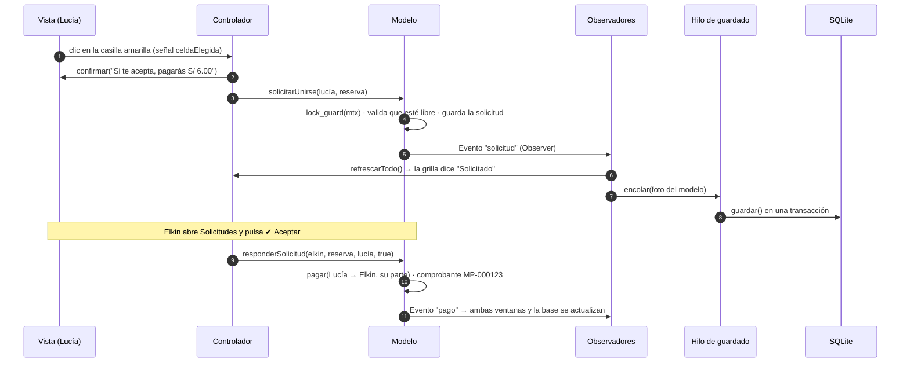

## 9. Reglas de negocio

| Regla | Valor |
|---|---|
| Días reservables | Próximos 7 días, turnos de 1 hora |
| Hora punta | Desde las 19:00, +20 % |
| Extras | Pelota S/ 5 · Chalecos S/ 8 · Árbitro S/ 20 |
| Pago | Simulado con la tarjeta guardada del jugador; el dueño recibe al instante; cada pago tiene un comprobante |
| Modos de reserva | **Privada**: "somos 10". **Buscar jugadores**: "somos 6, buscamos 4"; el precio se divide entre el total (máximo 14). **Buscar rival**: el capitán reserva con su equipo (5+ jugadores) y el equipo rival que acepte paga la mitad |
| Solicitudes | El organizador paga el total al dueño. Los jugadores (o los capitanes de otros equipos) envían una **solicitud**; si el organizador la acepta, le pagan su parte. Si la rechaza, no se cobra nada |
| Lista de espera | Si el partido ya está completo, la solicitud queda en lista de espera. Si alguien se retira a tiempo, se libera el cupo, se avisa al primero de la lista y el organizador puede aceptarlo |
| Límite para completar | Solo se puede buscar jugadores o rival reservando con **más de 24 h** de anticipación. 3 h antes del límite se avisa al organizador. Si a las **24 h** antes del partido no se completó, se **cancela solo y se devuelve todo** (sin multa para nadie). Con **"Jugar así"** el organizador cubre los cupos vacíos (ya los pagó) y el partido no se cancela (no aplica a equipo contra equipo: sin rival no hay partido). Si la app estuvo cerrada, la revisión se hace al abrirla |
| Choque de horarios | Un jugador no puede estar en dos partidos a la misma hora (al reservar, al pedir unirse ni al ser aceptado). En equipo contra equipo se revisa a todos los integrantes, y nadie puede estar en los dos equipos |
| Cancelación (organizador) | Con más de 24 h: se devuelve todo. Con menos: multa del 50 % para el dueño y 1 ★ al organizador. A los demás jugadores siempre se les devuelve su parte |
| Retiro (participante) | Con más de 24 h: se le devuelve su parte y el partido vuelve a buscar. Con 24 h o menos: sin devolución, 2 ★ y su cupo queda cubierto por lo que pagó. Si se retira el capitán rival, se va todo su equipo |
| Reputación bidireccional | Como en Airbnb, después de cada partido se califican ambos lados: los jugadores califican la cancha (1 a 5 ★, una vez) y el dueño califica a los jugadores con un botón: **Todo bien 5 ★**, **Llegaron tarde 3 ★**, **No vinieron 0 ★**. En equipo contra equipo se califica a todos los jugadores de ambos equipos. La reputación es el promedio de estrellas (un jugador nuevo empieza con 5) |
| Tolerancia de llegada | 25 minutos; recién entonces el dueño puede marcar "No vinieron" (sin devolución) |
| Torneos | 2 a 8 equipos de al menos 5 jugadores; un jugador no puede estar en dos equipos del mismo torneo; inscripción pagada por el capitán; todos contra todos; victoria 3 pts, empate 1 |
| Registro | El jugador elige su posición (arquero, defensa, volante o delantero) y registra su tarjeta; el dueño indica el nombre de su negocio |

## 10. Compilación y ejecución

### 10.1 Requisitos

- Compilador **C++17** (g++, clang o MSVC).
- **Qt 6** con los módulos *Widgets* y *SQL*. El driver de SQLite ya viene incluido en Qt.
- **CMake 3.16** o superior.

### 10.2 Compilar y ejecutar

**Con Qt Creator (recomendado, Windows/Linux/macOS):** *Archivo → Abrir archivo o proyecto →* `CMakeLists.txt`
→ elegir el kit de Qt 6 → ▶ Ejecutar.

**Por terminal:**
```bash
git clone <url-del-repositorio> matchpoint
cd matchpoint
cmake -S . -B build
cmake --build build
./build/matchpoint          # aplicación (en Windows: build\matchpoint.exe)
./build/pruebas             # 24 pruebas unitarias (o: ctest --test-dir build)
```
> Si CMake no encuentra Qt, indicar su ruta, por ejemplo:
> `cmake -S . -B build -DCMAKE_PREFIX_PATH=C:/Qt/6.x.x/mingw_64` (Windows) o `-DCMAKE_PREFIX_PATH=/opt/homebrew` (macOS).
> Sin Qt se compilan igual el modelo y las pruebas.

### 10.3 Usuarios de prueba (contraseña `1234`)

| Rol | Correo |
|---|---|
| Jugador | `elkin@matchpoint.pe`, `diego@matchpoint.pe`, `lucia@matchpoint.pe`, `jose@matchpoint.pe` (24 en total) |
| Dueño de cancha | `rosa@matchpoint.pe` (Complejo El Golazo), `luis@matchpoint.pe` (Sintéticos La Misti) |

La primera vez que se abre, la app crea **datos de ejemplo** que simulan los últimos 6 días con las mismas reglas
del sistema. Conviene abrirla entre las **9:00 y las 21:59**: así hay partidos de hoy por calificar y un partido
por vencer.

### 10.4 Recorrido guiado

**Como jugador** (`elkin@matchpoint.pe`):

1. **Canchas y reservar:** elegir *El Golazo*. La grilla muestra los próximos 7 días por hora, con colores:
   verde libre, amarillo busca jugadores, naranja busca rival, azul "Mi partido", rojo ocupado.
2. Hacer clic en una casilla verde, marcar *Pelota*, elegir el modo **Buscar jugadores** ("somos 6, buscamos
   4") y pulsar **Reservar y pagar con mi tarjeta**. Aparece el comprobante `MP-…`.
3. **Solicitudes:** aceptar o rechazar a Lucía y Pedro, y aceptar el reto del equipo Halcones FC.
4. **Mis reservas:** hay un partido por vencer, con su aviso en Notificaciones. Pulsar **Jugar así**.
5. Volver a la grilla, hacer clic en la casilla naranja de *Los Cóndores* y retarlos con Los Pumas.
6. Revisar **Mis pagos**, **Ranking** y **Notificaciones**.

**Como dueño** (`rosa@matchpoint.pe`):

1. **Mis canchas:** ver la ocupación de la semana y hacer clic en un horario para ver quién reservó.
2. **Reservas recibidas:** calificar un partido de hoy con ⭐ Todo bien, ⏰ Llegaron tarde o ❌ No vinieron.
3. **Torneos:** iniciar la *Copa El Golazo 2026* y registrar un resultado.
4. **Ingresos:** ver los cobros, las devoluciones y las multas.

La lista completa de pruebas está en [`docs/CASOS_DE_PRUEBA.md`](docs/CASOS_DE_PRUEBA.md): 50 casos con sus
pasos y el resultado esperado.

### 10.5 Datos y base SQLite

Los datos de ejemplo **simulan los últimos 6 días** con las
mismas reglas del sistema (`DatosDemo.cpp`): unas 200 reservas entre partidos jugados, inasistencias,
cancelaciones tardías y retiros, con sus pagos, devoluciones, multas y calificaciones. Por eso las canchas tienen
estrellas distintas, los jugadores tienen reputaciones variadas (aprox. de 3 a 5 ★) y la semana que viene ya está
ocupada, sobre todo en la noche y en los días más cercanos. En la demostración:

- **Elkin** tiene un partido con **dos solicitudes por responder** (Lucía y Pedro, con reputaciones distintas),
  un partido de su equipo **Los Pumas** que busca rival con el **reto de Halcones FC** por responder, y una solicitud
  enviada esperando respuesta. **Los Cóndores** buscan rival en El Golazo 2 (Elkin puede retarlos).
- Elkin también tiene un partido de **mañana que aún no se completa**: al abrir la app recibe el aviso de que se
  acerca el límite (24 h antes) y puede pulsar **"Jugar así"**; si no, se cancela solo con devolución total.
- **Rosa** tiene partidos de hoy que ya empezaron, listos para calificar a los jugadores.
- Ya terminó la "Copa Misti Relámpago" (4 equipos) y la "Copa El Golazo 2026" tiene inscripciones abiertas.

La simulación usa una semilla fija, así que siempre genera los mismos datos (relativos a la fecha de hoy).

Los datos se guardan automáticamente en la base **SQLite** `matchpoint.db`, en la carpeta de datos del usuario
(la ruta se muestra en la consola al iniciar; en macOS `~/Library/Application Support/MatchPoint/`). Tiene una
tabla por entidad: `usuarios`, `canchas`, `reservas`, `movimientos`, `equipos`, `torneos`, `partidos_torneo`,
`notificaciones` y `comprobantes`. Para volver a los datos de ejemplo basta con borrar ese archivo.

## 11. Resultados

### Capturas

**Canchas y reservar:** se elige la cancha, se hace clic en un horario de la grilla y se elige el modo.

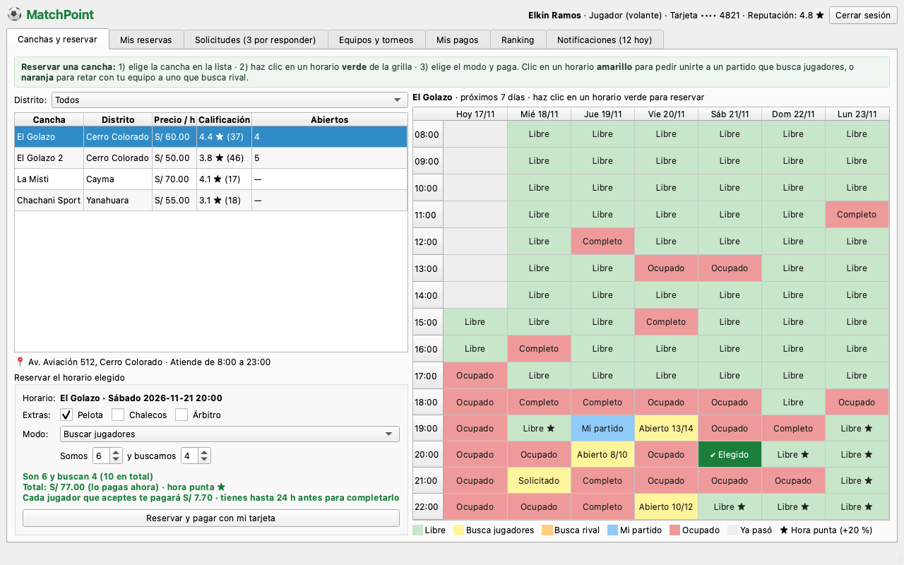

| Buscar equipo rival | Notificaciones |
|---|---|
| 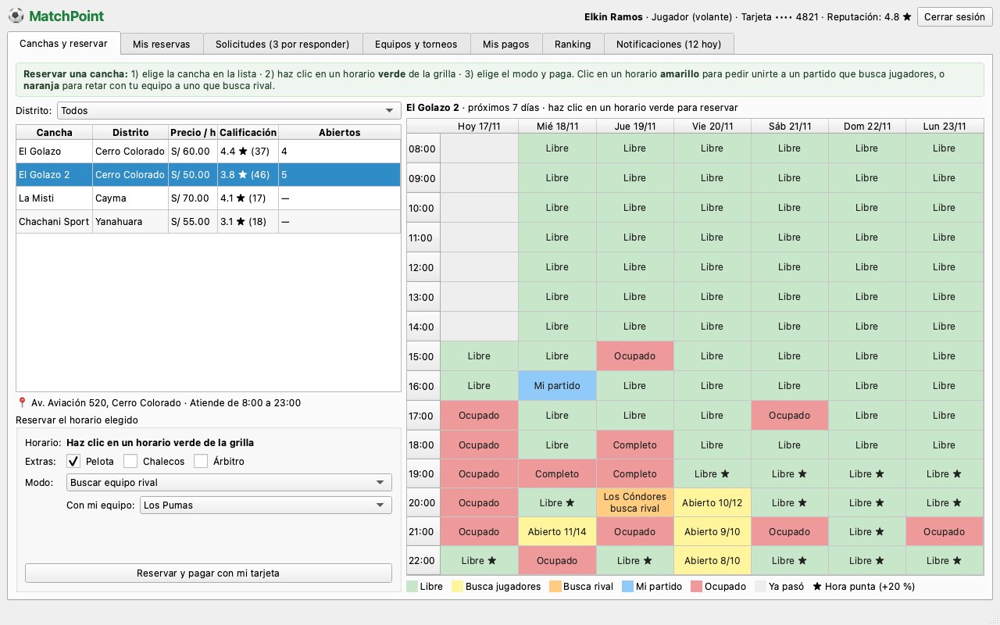 | 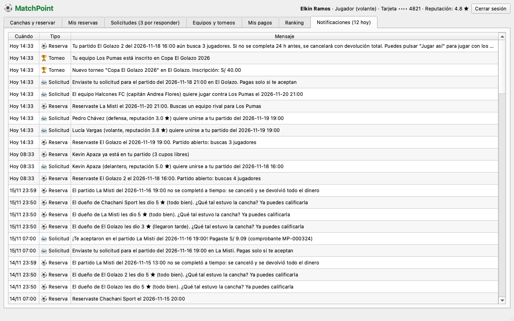 |

| Crear cuenta | Solicitudes (recibidas y enviadas) |
|---|---|
| 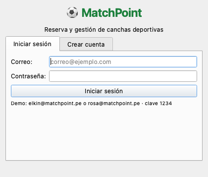 | 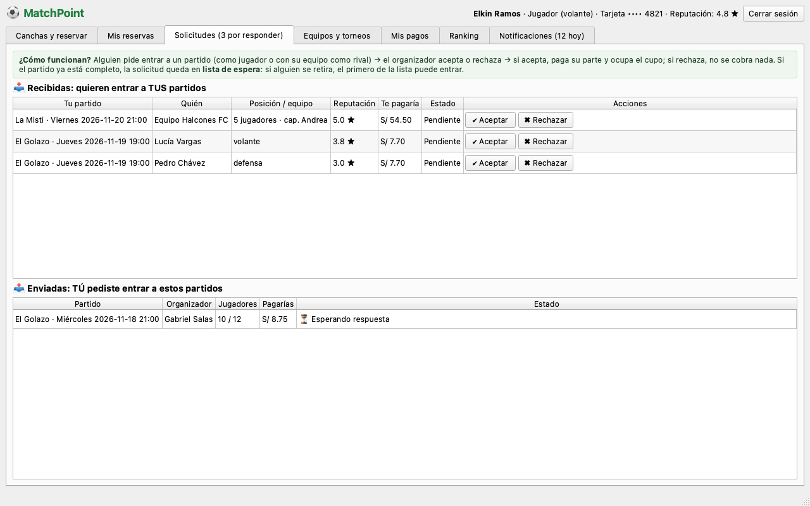 |

| Mis reservas (con historial) | Ranking |
|---|---|
| 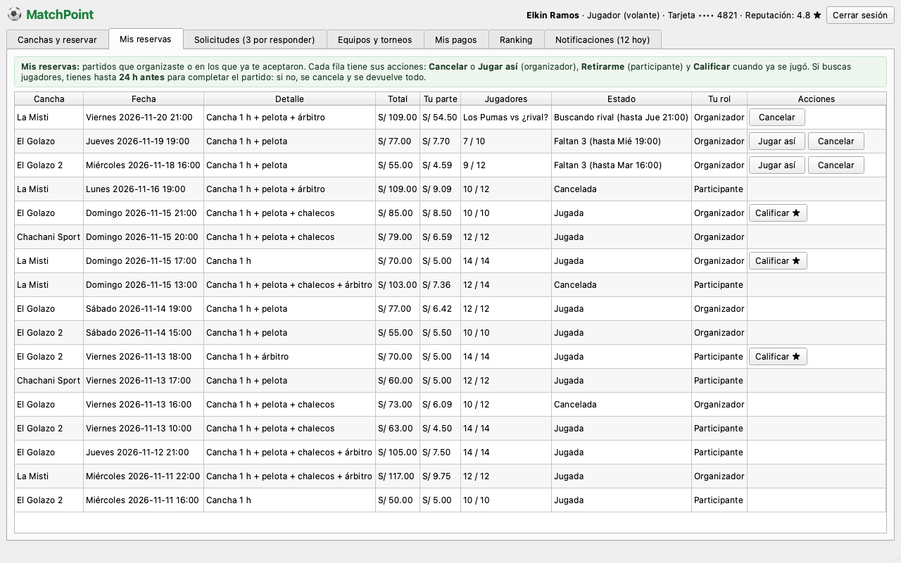 | 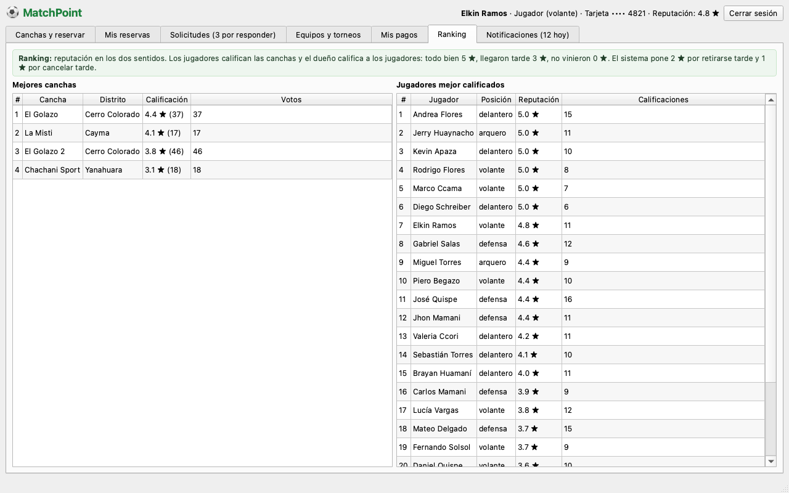 |

| Mis pagos (comprobantes) | Mis canchas (dueño) |
|---|---|
| 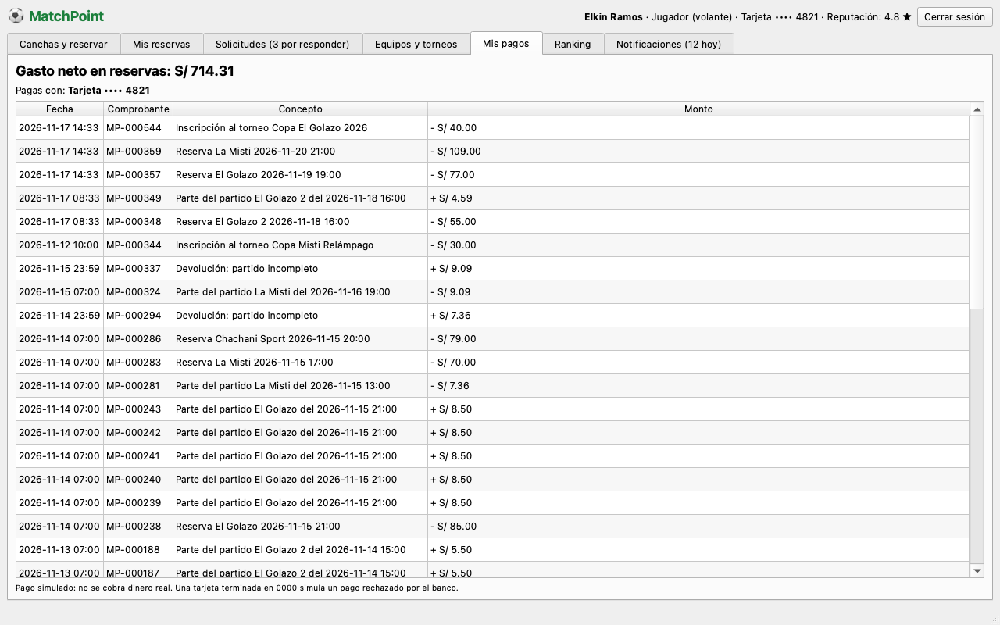 | 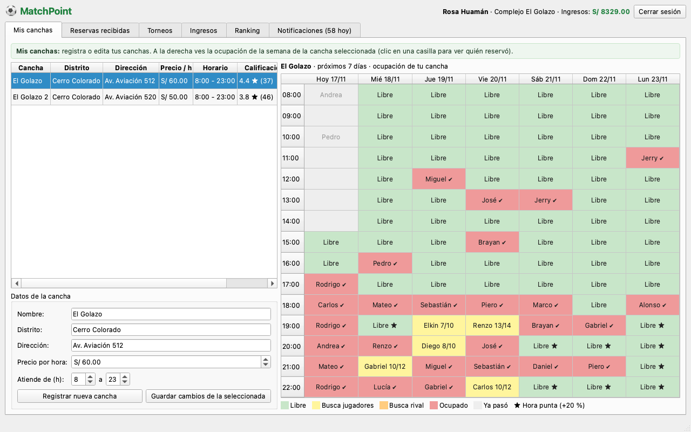 |

| Reservas recibidas (dueño) | |
|---|---|
| 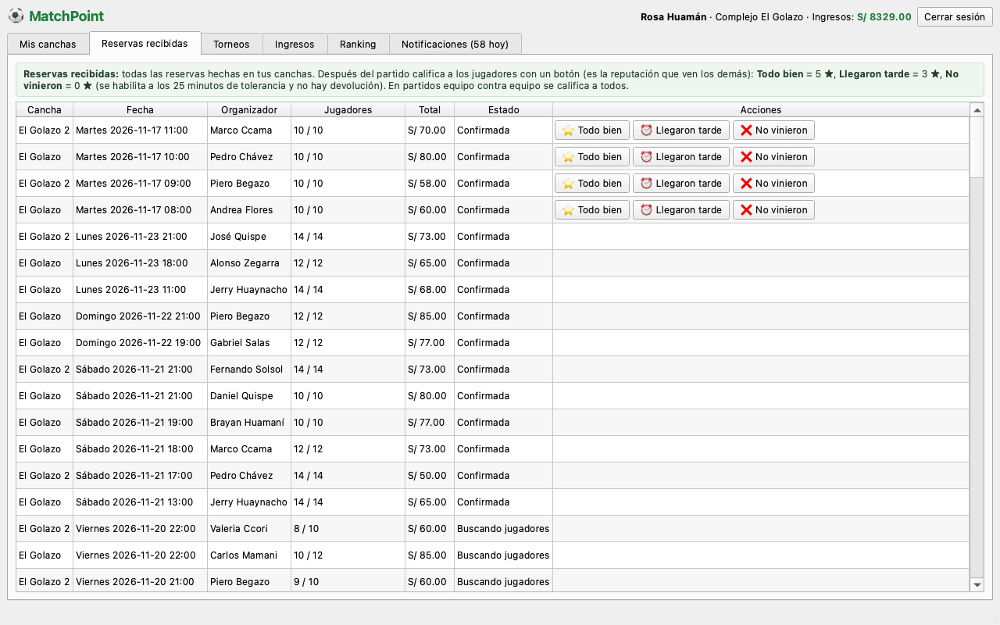 | |

| Equipos y torneos (jugador) | Torneo (dueño) |
|---|---|
| 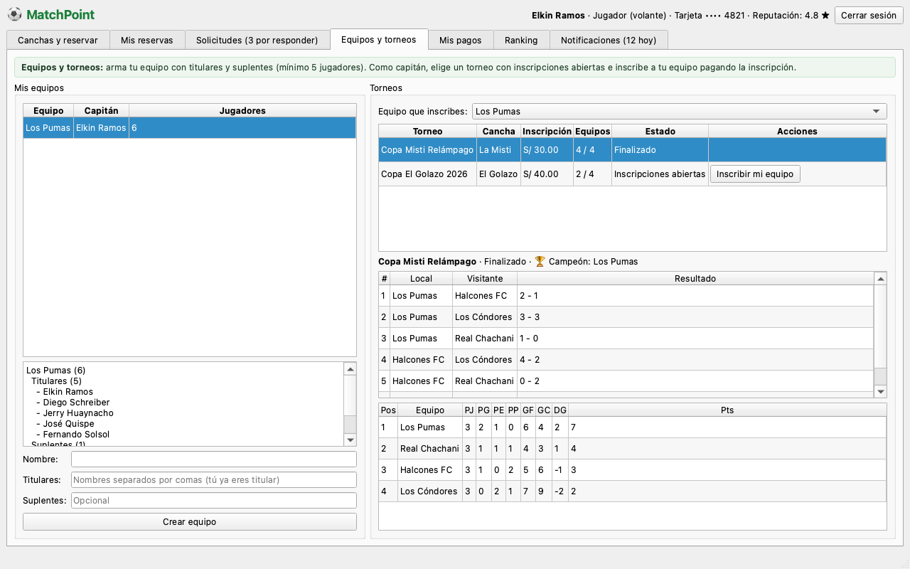 | 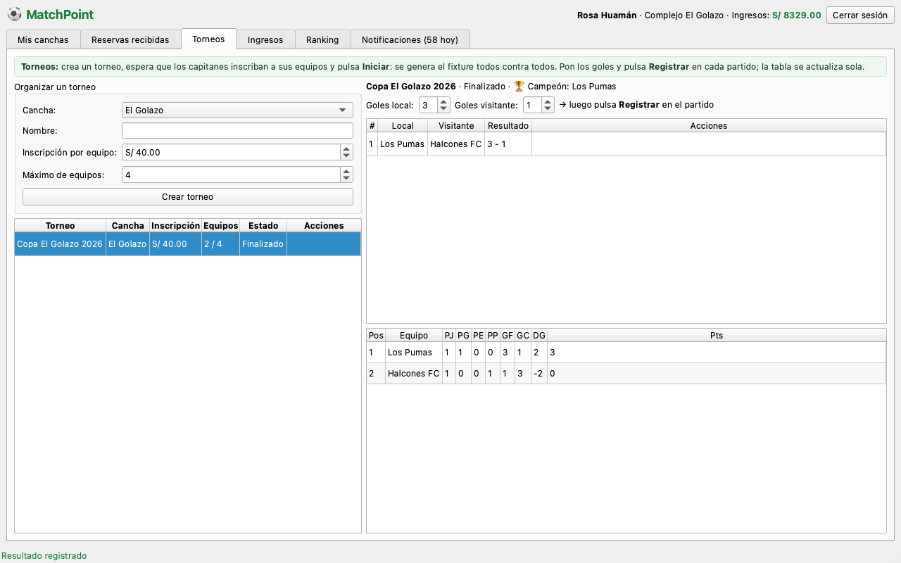 |

### Pruebas unitarias

`tests/pruebas_modelo.cpp` prueba el modelo sin abrir ventanas, con un **reloj fijo** para que el resultado no
dependa del día:

```text
[OK] Dinero: operadores + - * / < << y división entre 0
[OK] Usuarios: Factory Method, polimorfismo (medioDePago), login y tarjeta
[OK] Reserva: tarifa de hora punta (lambda) + extras (Decorator) + pago con comprobante
[OK] Reserva: horario ocupado, dueño no reserva, máximo 7 días
[OK] Partido abierto: solicitud, el organizador acepta y se divide el pago
[OK] Partido abierto: solicitud rechazada (no se cobra nada)
[OK] Retiro a tiempo con devolución y pago rechazado por el banco (PagoError)
[OK] Cancelación tardía: multa del 50 %, devolución a los demás y 1 ★ al organizador
[OK] Tolerancia de 25 minutos antes de marcar 'No se presentaron' (0 ★)
[OK] Reputación bidireccional: el dueño califica (tarde = 3 ★) y el jugador califica la cancha
[OK] Equipos con Composite: titulares + suplentes
[OK] Torneo: inscripción pagada, fixture, resultado y tabla de posiciones
[OK] Reserva privada y partido abierto: "somos X, buscamos Y"
[OK] Un jugador no puede tener dos partidos a la misma hora
[OK] Partido incompleto: aviso antes del límite y cancelación con devolución total a las 24 h
[OK] "Jugar así": el organizador cubre los cupos y el partido no se cancela
[OK] Lista de espera: si alguien se retira, entra el primero de la lista
[OK] Equipo contra equipo: el rival aceptado paga la mitad (Composite: equipos de 5+)
[OK] Revisión: partido vencido con la app cerrada, frontera de 24 h, equipos repetidos y canchas
[OK] Grilla semanal: libre, ocupado, partido abierto, mi partido y hora punta
[OK] Multithreading: 2 hilos reservan a la vez y solo uno lo logra (50 repeticiones)
[OK] Observer: el modelo notifica a sus suscriptores
[OK] Persistencia: guardar y volver a cargar deja los mismos datos
     (229 reservas, 9 jugadores con reputación baja)
[OK] Datos de ejemplo: historial simulado con reputaciones y calificaciones variadas
24 pruebas pasaron
```

También se puede ejecutar con `ctest --test-dir build`.

### Pruebas de aceptación

[`docs/CASOS_DE_PRUEBA.md`](docs/CASOS_DE_PRUEBA.md) tiene **50 casos** para probar la aplicación como un usuario
real, repartidos por rol (cuenta, reservas, solicitudes, equipos y torneos, dueño). Cada caso tiene sus pasos, el
resultado esperado y una casilla "Pasó". Se ejecutaron sobre la interfaz en distintas fechas y horas (incluidos
los días de exposición): **50 de 50 pasan**.

## 12. Ventajas y consideraciones

| ✅ Ventajas | ⚠️ Consideraciones |
|---|---|
| El modelo no depende de Qt: se prueba sin ventanas y se podría reutilizar en otra interfaz | Funciona en una sola computadora (sin servidor ni red) |
| Agregar un extra o un tipo de usuario no obliga a cambiar el resto (Decorator, Factory Method) | El pago es simulado; uno real necesitaría una pasarela externa |
| El `mutex` evita reservas duplicadas y el guardado en otro hilo no congela la ventana | Guardar la "foto" completa es simple, pero no escalaría a miles de reservas |
| Cada regla tiene una prueba y cada error encontrado se convirtió en una prueba nueva | La contraseña usa un hash simple (FNV-1a), no criptográfico |

### Decisiones de diseño

| Pregunta | Respuesta |
|---|---|
| ¿Por qué el modelo no usa Qt? | Para separar de verdad las capas (MVC): las reglas se prueban sin abrir ventanas y la interfaz se podría cambiar sin tocar el modelo. |
| ¿Por qué Observer, si no está en la teoría? | Se vio en el Lab 08 (GoF) y es la forma natural de que el modelo avise a la ventana, a las notificaciones y al guardado sin conocerlos. |
| ¿Cómo se evita que dos personas reserven la misma hora? | Cada operación del modelo toma un `std::mutex` (`lock_guard`); la prueba lanza 2 hilos que reservan el mismo horario 50 veces y siempre gana uno solo. |
| ¿Por qué se guarda en SQLite una "foto" completa? | Los datos son pocos (cientos de filas): reescribirlos en una transacción es simple y nunca deja la base a medias. Lo hace un hilo aparte, así la ventana no se congela. |
| ¿Por qué la revisión de partidos incompletos usa un temporizador y no un hilo? | La ventana lee el modelo sin bloquearlo; si un hilo lo modificara al mismo tiempo habría condiciones de carrera. El `QTimer` corre en el hilo de la interfaz y evita ese riesgo. |
| ¿Por qué el pago es simulado? | Un pago real requiere una pasarela externa (fuera del alcance del curso). Se simula con la tarjeta guardada, comprobantes y una tarjeta que el "banco" rechaza (`0000`) para mostrar el manejo de errores. |
| ¿Por qué solo fútbol? | Varios deportes (reglas, tamaños de equipo y canchas distintas) complicarían la lógica sin aportar a los objetivos del curso. |
| Limitaciones conocidas | Funciona en una sola computadora (sin servidor ni red); la contraseña se guarda con un hash simple (FNV-1a), no criptográfico; las notificaciones son internas de la app; no hay recuperación de contraseña. |

## 13. Conclusiones

- Se desarrolló **MatchPoint** con arquitectura **MVC**: el modelo (reglas y datos) no incluye Qt, la vista solo
  muestra y emite señales, y el controlador traduce entre ambos. Gracias a eso las reglas se prueban sin abrir
  ventanas.
- Se aplicaron **dos patrones creacionales** (Factory Method para crear usuarios, Singleton para la
  configuración) y **dos estructurales** (Decorator para los extras, Composite para los equipos), además de
  Observer para avisar los cambios a la ventana y al guardado.
- Los conceptos de POO avanzada resolvieron necesidades reales: `Repositorio<T>` y `unique_ptr` para guardar los
  datos sin fugas de memoria, excepciones propias para mostrar errores claros, `Dinero` con operadores para no
  perder céntimos y un `mutex` para que dos hilos nunca reserven el mismo horario.
- El sistema se validó con **24 pruebas unitarias**, **50 casos de aceptación** sobre la interfaz y una
  compilación sin advertencias. Los errores que encontraron las pruebas se corrigieron y quedaron cubiertos para
  que no vuelvan.

## 14. Exposición y video

Exposiciones: **20, 26 y 27 de diciembre de 2026**. Entregables: este repositorio, el informe, el artículo,
las diapositivas y un **video de máximo 7 minutos en el que participan los 5 integrantes**. El mismo guion
sirve para el video y para la exposición en vivo.

**Antes de empezar:** borrar `matchpoint.db` para partir de los datos de ejemplo, abrir la app entre las 9:00 y
las 21:59 y tener abiertos en el editor los archivos que se van a mostrar.

### 14.1 Guion (≈ 6 min 40 s)

| Tiempo | Integrante | Tema | Qué mostrar | Qué decir |
|---|---|---|---|---|
| 0:00 – 1:20 | **Elkin Ramos** | Problema, solución y reserva | Login con `elkin@`; grilla de El Golazo; reservar con *Buscar jugadores* (6 + 4) y *Pelota* | Reservar por WhatsApp genera cruces de horario y cancelaciones. MatchPoint muestra la disponibilidad real, divide el pago y completa jugadores. La hora punta (+20 %) es una **lambda** y la pelota es un **Decorator** |
| 1:20 – 2:40 | **Diego Schreiber** | Solicitudes y partido incompleto | Solicitudes: aceptar a Lucía (paga su parte) y rechazar a Pedro; aceptar el reto de Halcones FC; *Jugar así* en el partido por vencer | Solo se paga al ser aceptado; si el partido se llena, la solicitud pasa a la **lista de espera**; 24 h antes un partido incompleto se cancela solo con devolución total. Equipo contra equipo usa **Composite** |
| 2:40 – 3:50 | **Jerry Huaynacho** | Dueño de cancha | Login con `rosa@`; grilla de su cancha; *Todo bien / Llegaron tarde / No vinieron*; iniciar torneo y registrar resultado; Ingresos | **Reputación bidireccional** (como Airbnb): el dueño califica a los jugadores y ellos califican la cancha. Tolerancia de 25 min. Cancelar tarde deja una multa del 50 % |
| 3:50 – 5:20 | **José Quispe** | Arquitectura y patrones | Diagrama MVC (sección 5.1) y flujo (sección 8); `UsuarioFactory.h`, `Configuracion.h`, `ServicioReserva.h`, `Equipo.h`, `suscribir()` en `ModeloMatchPoint.h` | **MVC:** el modelo no incluye Qt, la vista no conoce el modelo. **Creacionales:** Factory Method y Singleton. **Estructurales:** Decorator y Composite. **Observer:** el modelo avisa a la ventana y al guardado |
| 5:20 – 6:40 | **Fernando Solsol** | POO avanzada, calidad y herramientas | `Repositorio.h` (template), `Excepciones.h`, `Dinero.h` (operadores), `lock_guard` y `GuardadoAsincrono.cpp`; ejecutar `./build/pruebas`; `git log` | **Herencia/polimorfismo** (`Usuario` → `Jugador`/`DuenoCancha`), `unique_ptr`, templates, excepciones, lambdas, operadores. **Hilos:** mutex y productor-consumidor que guarda en **SQLite**. 24 pruebas unitarias y 50 de aceptación; CMake y Git. Cierre: impacto social |

### 14.2 Cómo cumple cada criterio de la rúbrica

| Criterio | Peso | Dónde se demuestra |
|---|---|---|
| Diseño | 20 | MVC con capas separadas (sección 5); 2 creacionales + 2 estructurales + Observer (sección 6); cohesión y bajo acoplamiento (sección 7) |
| POO avanzada | 20 | Herencia, polimorfismo, clases abstractas, `unique_ptr`, `Repositorio<T>`, jerarquía de excepciones, lambdas, sobrecarga de operadores, `mutex` e hilo productor-consumidor (sección 7) |
| Calidad | 20 | 24 pruebas unitarias con reloj fijo, prueba de concurrencia, 50 casos de aceptación (sección 11); compila sin advertencias (`-Wall -Wextra`) |
| Innovación | 15 | Grilla semanal de colores, "somos X, buscamos Y", equipo contra equipo, lista de espera, plazo de 24 h con "Jugar así", reputación bidireccional, pago simulado con comprobantes |
| Herramientas | 15 | C++17, Qt 6, SQLite (Qt SQL), CMake, Git/GitHub |
| Presentación | 10 | Guion de 14.1, video de máximo 7 minutos con los 5 integrantes, README con capturas y diagramas |

**Impacto social:** facilita organizar partidos en el barrio (completar equipos sin conocerse), reduce las
inasistencias con la reputación y ayuda a los pequeños negocios de canchas a ordenar sus reservas y cobros.

### 14.3 Preguntas que pueden hacer

Las respuestas están en [12. Ventajas y consideraciones](#12-ventajas-y-consideraciones): por qué el
modelo no usa Qt, por qué Observer, cómo se evita la doble reserva, por qué SQLite como "foto", por qué un
`QTimer` y no un hilo, por qué el pago es simulado y por qué solo fútbol. También:

| Pregunta | Respuesta |
|---|---|
| ¿Por qué de escritorio y no web? | El curso es de POO en C++ y la herramienta vista es Qt (Labs 04 y 09). Una web exigiría otro lenguaje y un servidor. Como el modelo no depende de Qt, se podría reutilizar en una versión web o móvil sin cambiarlo |
| ¿Cómo saben que funciona? | Cada regla tiene una prueba unitaria; cada error encontrado se convirtió en una prueba nueva; los 50 casos de aceptación se ejecutaron sobre la interfaz y pasan todos |

## 15. Estructura del repositorio

```
matchpoint/
├── CMakeLists.txt                  compilación (modelo, app y pruebas)
├── README.md
├── src/
│   ├── main.cpp                    arma el MVC y carga los datos
│   ├── modelo/                     reglas de negocio (sin Qt)
│   │   ├── ModeloMatchPoint.*    fachada del modelo + Observer + mutex
│   │   ├── Usuario.h, Jugador.h, DuenoCancha.h, UsuarioFactory.h
│   │   ├── Cancha.*, Reserva.*, ServicioReserva.* (Decorator)
│   │   ├── Equipo.h (Composite), Torneo.*
│   │   ├── Billetera.*, Dinero.*, FechaHora.*
│   │   ├── Repositorio.h (template), Configuracion.h (Singleton), Excepciones.h
│   ├── persistencia/               SQLite (BaseDatos), foto del modelo, hilo de guardado, datos de ejemplo
│   ├── vista/                      ventanas Qt
│   └── controlador/                conexión vista ↔ modelo
├── tests/pruebas_modelo.cpp        pruebas unitarias (24)
├── entregables/                    informe, artículo y diapositivas (PDF, Word y PowerPoint)
└── docs/
    ├── CASOS_DE_PRUEBA.md          pruebas de aceptación (50 casos)
    └── img/                        capturas
```

## 16. Integrantes

| Apellidos y nombres | Usuario GitHub |
|---------------------|----------------|
| Huaynacho Mango Jerry Anderson | [@JerryCode777](https://github.com/JerryCode777) |
| Quispe Mamani Jose Gabriel | [@J-Gabriel-Quispe-M](https://github.com/J-Gabriel-Quispe-M) |
| Ramos Ochochoque Elkin Eder B. | [@elkinramos8](https://github.com/elkinramos8) |
| Schreiber Landeo Diego Hans | [@Diego-Schreiber](https://github.com/Diego-Schreiber) |
| Solsol Choque Fernando Rafael | [@Fernando-Solsol](https://github.com/Fernando-Solsol) |

## 17. Referencias

- Gamma, E., Helm, R., Johnson, R. y Vlissides, J. (1994). *Design patterns: Elements of reusable object-oriented software*. Addison-Wesley.
- Stroustrup, B. (2013). *The C++ programming language* (4.ª ed.). Addison-Wesley.
- The Qt Company. (s. f.). *Signals & Slots*. https://doc.qt.io/qt-6/signalsandslots.html
- The Qt Company. (s. f.). *SQL Programming*. https://doc.qt.io/qt-6/sql-programming.html
- cppreference.com. (s. f.). *std::unique_ptr*. https://en.cppreference.com/w/cpp/memory/unique_ptr
- cppreference.com. (s. f.). *std::mutex*. https://en.cppreference.com/w/cpp/thread/mutex
- Refactoring.Guru. (s. f.). *Patrones de diseño*. https://refactoring.guru/es/design-patterns
- SQLite. (s. f.). *About SQLite*. https://www.sqlite.org/about.html

---

<div align="center"><sub>Proyecto final · Tecnología de Objetos · UNSA 2026</sub></div>
